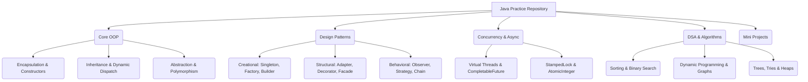

<div align="center">
  <h1>☕ Java Practice & Interview Solutions</h1>
  <p><i>A comprehensive, curated repository of Java concepts, data structures, algorithms, and design patterns.</i></p>
  
  
  
  
  
</div>

<hr />

## 📖 Table of Contents
- [About The Project](#about-the-project)
- [Architecture & Flow](#architecture--flow)
- [Repository Structure](#repository-structure)
  - [Core Java & OOP](#-core-java--oop)
  - [Design Patterns](#-design-patterns)
  - [Concurrency & Advanced APIs](#-concurrency--advanced-apis)
  - [Data Structures & Algorithms](#-data-structures--algorithms)
  - [Application Workflows](#-application-workflows)
- [Algorithm Complexity Index](#-algorithm-complexity-index)
- [How to Run](#-how-to-run)
- [Recent Updates & Roadmap](#-recent-updates--roadmap)

---

## 🎯 About The Project

This repository serves as a **knowledge base** and a **practice playground** for Java engineering. It encompasses a wide array of implementations ranging from foundational Object-Oriented Programming (OOP) to advanced asynchronous concurrency, architectural design patterns, and high-performance algorithms. Built for continuous daily engineering growth and technical interview excellence.

---

## 🏗 Architecture & Flow



---

## ⚡ Algorithm Complexity Index

| Algorithm | Category | Time Complexity (Best / Avg / Worst) | Space Complexity |
| :--- | :--- | :--- | :--- |
| **QuickSort** (3-Way / Median-of-3) | Sorting | `O(n log n)` / `O(n log n)` / `O(n log n)` | `O(log n)` |
| **Binary Search** | Searching | `O(1)` / `O(log n)` / `O(log n)` | `O(1)` |
| **Boyer-Moore String Search** | String Matching | `O(n/m)` / `O(n)` / `O(nm)` | `O(m + |Σ|)` |
| **Kosaraju SCC** | Graph Theory | `O(V + E)` / `O(V + E)` / `O(V + E)` | `O(V)` |
| **Red-Black BST** | Self-Balancing Tree | `O(log n)` / `O(log n)` / `O(log n)` | `O(n)` |
| **Shunting-Yard Parser** | Parsing | `O(n)` / `O(n)` / `O(n)` | `O(n)` |
| **Segmented Sieve** | Number Theory | `O((R - L + 1) log log R)` | `O(√R)` |

---

## 🚀 How to Run

Compile and execute any source file using modern Java (JDK 21+):

```bash
# Compile
javac Algorithms/AnagramCheck.java

# Execute
java Algorithms.AnagramCheck
```

---

## 📈 Recent Updates & Roadmap

- **Nov 2026**: Systematically refactored core OOP suites, enhanced mathematical algorithms (Stein's Binary GCD, Segmented Sieve, Aliquot Sums), and upgraded mini-projects with production patterns.
